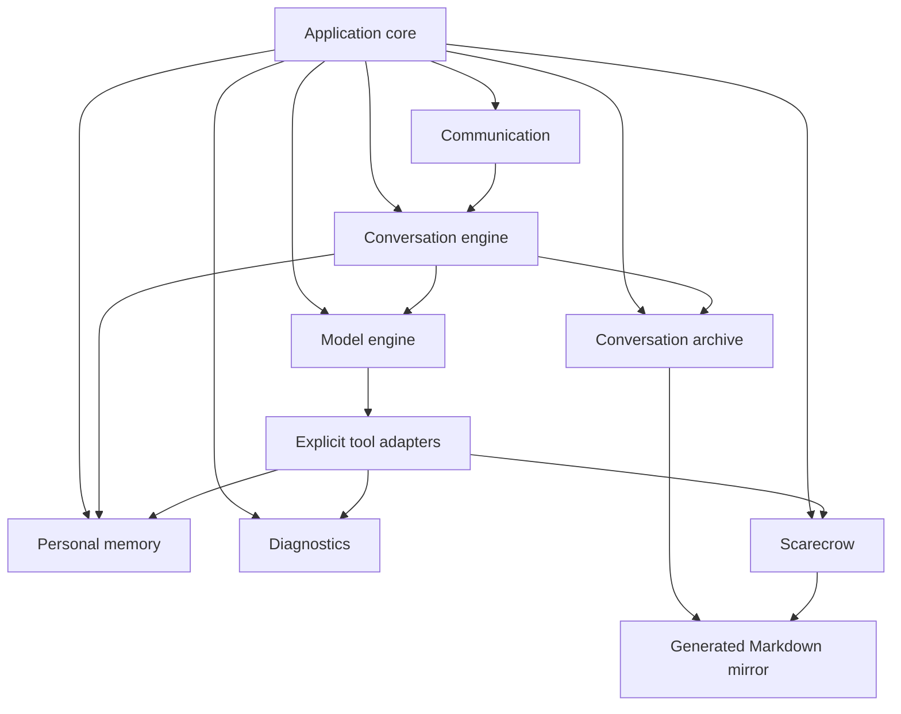

# Project-wide subsystem map

This is the ownership map for Marionette's current source tree. Use the eight names below when discussing an upgrade or replacement. These are maintenance groups, not a claim that the implementation is already isolated behind interchangeable interfaces. No files or runtime behavior were changed to establish this map. Scarecrow is the existing component name; the other names are descriptive identifiers, not newly chosen character names.

Every production Python module, Scarecrow source file, native setup/launch file and prompt has one primary owner below. A primary owner is responsible for maintaining a file; dependent subsystems still participate in changes to shared behavior. Keep this map updated when adding, moving or splitting those files. Tests listed below are relevant checks, not exclusive ownership boundaries or proof of answer quality.

## Ownership inventory

Paths in the Python column are relative to `src/marionette/`. Script paths are relative to `scripts/native-linux/`. Prompt paths are relative to `prompts/`.

| Subsystem | Primary Python files | Supporting source, scripts and prompts |
|---|---|---|
| **Application core** | `session.py`, `memory_reset.py`, `reset_boundary.py` | `chat.sh`, `setup.py`, `downloads.json`; root `STARTUP.md` |
| **Conversation engine** | `conversation.py`, `context.py`, `commands.py`, `permissions.py` | No separate setup script |
| **Model engine** | `inference.py`, `coordination.py` | `setup-agent.sh`, `agent-requirements.in`, `agent-requirements.txt`; `tool-guidance.md`, `prompt-guide.md` |
| **Personal memory** | `contacts.py`, `contact_notes.py`, `soul.py`, `data_migration.py` | `contact-notes.md`, `soul.md` prompts |
| **Conversation archive** | `storage.py`, `conversation_refs.py`, `conversation_vault.py` | `storage.sh`, `sync-conversation-vault.sh` |
| **Diagnostics** | `diagnostics.py`, `ram_logs.py`, `retention.py`, `log_router.py`, `log_metadata.py`, `log_view.py`, `log_query.py`, `log_tool.py`, `setup_datasheet.py` | `view-log.sh`, `log-query.sh`; `log-queries.md`, `log-results.md` prompts |
| **Communication** | `terminal.py`, `style.py`, `connection.py`, `discord_bot.py`, `discord_control.py`, `operator_status.py` | `discord.sh`, `setup-discord.sh`, `discord-requirements.in`, `discord-requirements.txt` |
| **Scarecrow** | `vault_tool.py`, `vault_diagnostics.py` | All of `plugins/scarecrow/`: `main.js`, `server.js`, `operations.js`, `search.js`, `passages.js`, `manifest.json`, `LICENSE`; `setup-scarecrow.py`; `vault.md` prompt |

Application-wide rules remain in root `AGENTS.md`; repository navigation remains in root `README.md`. Active guides describe behavior and maintenance, while development reports are historical evidence. Neither an experiment nor an idea changes subsystem ownership or authorizes implementation.

## How the groups connect

The following is a responsibility flow, not a complete import graph:

Components emit events through Diagnostics; those edges are omitted for readability. Scarecrow searches the generated mirror, not live SQLite conversations. The archive exporter produces that mirror. Memory reset is coordinated by Application core across all affected groups.

## Application core

**Responsibility:** compose the application, launch and observe the inference runtime, own startup/shutdown sequencing, and coordinate memory reset. Core setup owns shared runtime/model installation selection; the Model engine owns the Python inference/tool integration.

**Current connections:** `chat.sh` establishes locks, recorder processes, environment and session descriptors; `session.py` constructs concrete component objects and starts/stops the model server. `memory_reset.py` receives the live Conversation object and reaches into its components. `reset_boundary.py` supplies the generation protocol used by recorders and connections. These are concrete lifecycle contracts, not a generic component registry.

**Preserve on replacement:** established launch commands; shared AI infrastructure paths and verified download reuse; loopback runtime ownership and readiness checks; orderly recorder draining before shutdown export; owner-only reset and permanent UUID/account mappings; reset generation acknowledgements and fail-closed behavior after an incomplete reset. Restart must remain distinct from memory reset. Follow the full [reset guide](../current-operation/reset-memory.md) and repository operator instructions.

**Checks:** `tests/core/test_setup.py`, `test_startup.py`, `test_client.py`, `test_memory_reset.py`, plus recorder, connection and personal-state tests when lifecycle/reset interactions change. Runtime/model changes also require the publisher-guidance and real-generation verification in the [setup guide](setup.md); unit tests alone are insufficient.

## Conversation engine

**Responsibility:** choose the correct conversation, serialize turns, maintain separate active histories, authorize commands and fit complete exchanges into the model context.

**Current connections:** Communication calls turn/submission methods. Conversation calls the Model engine's count/reply/preparation functions, binds concrete tools for the current identity, and writes through `Store.message`. Context preparation also accesses mutable API state. It is independent of terminal rendering imports but still knows terminal/Discord source types and concrete personal-memory/log tools.

**Preserve on replacement:** per-sender/per-source history separation; linked contacts sharing notes without merging conversations; sequential generation/preparation; owner checks enforced in code; whole-exchange trimming including tool calls/results; no replay of past reasoning or re-execution of old tools; failed-turn history handling; exact token budgets and safe cache rollover. Preserve the documented distinction between saved conversations and active context after restart.

**Checks:** `tests/core/test_conversations.py`, `test_exchange_history.py`, `test_commands.py`, `test_permissions.py`, and relevant inference, contact-note and reset tests. See [context policy](../current-operation/context.md) and [tool-turn behavior](../current-operation/qwen-agent.md).

## Model engine

**Responsibility:** communicate with the local inference server, render/count the native template, generate responses, prepare runtime caches and coordinate explicit model/tool turns.

**Current connections:** `API` is the main interface used by Conversation, but exposes mutable fields such as tools, capacity, system prompt, worker and response messages. `inference.py` also assembles feature prompts and converts Qwen-Agent messages. `Coordinator` inherits the pinned Qwen-Agent loop; tool implementations elsewhere inherit its `BaseTool`. Replacing llama.cpp and replacing Qwen-Agent are different changes with overlapping affected code.

**Preserve on replacement:** accurate template/token counting for the same messages actually sent; explicit tool schemas and dispatch; refusal of incomplete tool requests; streamed reasoning/final-answer separation; completion/error reporting; retained tool-call IDs and result messages; cancellation and worker shutdown; local operation with no required hosted service. Maintain the existing per-request budget checks and pinned integration behavior unless the replacement explicitly changes their contract.

**Checks:** `tests/core/test_inference.py`, `test_coordination.py`, `test_tool_summaries.py`, `test_exchange_history.py`, `test_client.py`; tool-adapter tests when the framework changes. `tests/core/fake_server.py` is synthetic test infrastructure. See [Qwen-Agent integration](../current-operation/qwen-agent.md), [context](../current-operation/context.md), [setup](setup.md) and [licenses](licenses.md). Revalidate sampling, templates, reasoning and generation when changing model/runtime, not just transport compatibility.

## Personal memory

**Responsibility:** permanent identities and owner/account links, contact notes, editable soul and their format migrations. This group does not own the conversation archive or active context.

**Current connections:** Conversation resolves identities and supplies current notes; model-facing update adapters live beside their storage implementations. `Soul.bind` updates Model engine state. Reset coordinates directly with profile, note and soul implementations. Contact notes and soul share some utilities, so they are not completely independent implementations.

**Preserve on replacement:** permanent UUIDs; owner and linked-account mappings; portable formats and provenance; revision history where specified; note-size and edit validation; current-contact scope of note writes; explicit uncertainty versus facts; blank soul behavior; reset scope and safe migrations. Do not infer new authorization from model text or a contact's display name.

**Checks:** `tests/core/test_contacts.py`, `test_contact_notes.py`, `test_soul.py`, `test_data_migration.py`, `test_permissions.py`, `test_memory_reset.py`. See [contacts](../current-operation/contacts.md), [contact notes](../current-operation/contact-notes.md) and [soul](../current-operation/soul.md).

## Conversation archive

**Responsibility:** durable conversation records and identifiers, SQLite schema/recovery/export, and generation of the Markdown conversation/contact/documentation mirror. The exporter belongs here because it creates a view of stored data; Scarecrow consumes that view.

**Current connections:** `Store` is a partial interface, but SQL is also used directly by the exporter, diagnostic queries/recorder, session/conversation wiring and reset. `storage.py` additionally hosts diagnostic schema, capture/view entry points and shared helpers. Archive ownership of that file does not grant permission to alter diagnostic durability. `conversation_refs.py` defines citations consumed by contact notes and the exporter. The exported Markdown structure is consumed by Scarecrow passage extraction.

**Preserve on replacement:** saved message roles, identities, correlation IDs, timestamps and provenance; stable conversation references; documented portable export; database consistency during backup/reset/export; no loss of user data during migration; one-way generated mirror ownership and private-data locations. Keep synthetic data out of real profiles. Test same-version restoration separately from cross-database migration; do not treat one as proof of the other.

**Checks:** `tests/core/test_storage.py`, `test_conversation_refs.py`, `test_conversation_vault.py`, `test_memory_reset.py`, plus recorder/query tests for schema changes and Scarecrow passage tests for mirror-format changes. See [storage and recovery](../current-operation/storage.md) and [vault mirror](conversation-vault.md).

## Diagnostics

**Responsibility:** event identities/scopes, rolling RAM capture, protected error evidence, shutdown saving, operator views, searchable diagnostic metadata and the scoped log-query tool. Startup observations belong here even though Application core triggers their capture.

**Current connections:** `diagnostics.write/log` is the common emission interface. RAM recording, retention and log queries also use shared SQL schemas and each other's helpers; `storage.py` and `ram_logs.py` have mutual dependencies. Queries combine durable/live events and Communication/Scarecrow status probes. `log_view.py` uses Communication's style helpers. There is no complete replaceable recorder/storage interface yet.

**Preserve on replacement:** the existing recorder's 500,000,000-byte raw-event RAM budget in 20,000,000-byte batches; latest-20 protected error windows with 20 events before/after; durable conversations; no routine per-event diagnostic payload writes or extra helper process; orderly shutdown saving; live operator views and stable IDs; query scope and reset-generation boundaries; credentials/content exclusions in connector diagnostics. Preserve the stated possibility of losing unsaved RAM on SIGKILL, OOM, OS crash or power loss. Changes to this policy require an explicit decision, retention-guide updates and the required recorder regression checks.

**Checks:** `tests/core/test_logs.py`, `test_message_logs.py`, `test_ram_logs.py`, `test_retention.py`, `test_log_metadata.py`, `test_log_view.py`, `test_log_query.py`, `test_log_tool.py`, `test_setup_datasheet.py`, plus reset/storage and connector-diagnostic tests. See [retention](../current-operation/log-retention.md), [logs](../current-operation/logs.md) and [log queries](../current-operation/log-queries.md).

## Communication

**Responsibility:** terminal presentation/input, Discord DM transport, local request routing, delivery and connection lifecycle/status. This group does not choose the model or own durable conversation history.

**Current connections:** terminal drives the main processing loop; Discord submits through the local socket and Conversation's queue. `LocalConnection` is currently a Discord-shaped protocol, including sender ID validation, not a generic transport API. Discord lifecycle and status are connected to Application core and diagnostic probes. Shared style functions are also used by diagnostic views.

**Preserve on replacement:** identity and correlation metadata; queueing/serialization; reset-generation rejection; owner authorization for controls; final-answer-only Discord delivery; delivery/error observations distinct from generation success; supported background start/stop and recorder shutdown; no credential disclosure. Preserve one-to-one human DM scope unless expanding it is separately authorized.

**Checks:** `tests/core/test_connection.py`, `test_discord_control.py`, `test_client.py`, `test_message_logs.py`, and `tests/discord/test_discord.py`, `test_launcher.py`. See [Discord operation](discord.md) and root `STARTUP.md`. Mocked transport tests do not prove live Discord delivery or reconnect reliability.

## Scarecrow

**Responsibility:** the optional Obsidian plugin and Marionette adapters providing vault browsing, passage retrieval, metadata/links, UI opening and connector diagnostics. The whole integration is the project-wide Scarecrow replacement unit; its implementation details remain in the [Scarecrow guide](obsidian-connection.md).

**Current connections:** `read_vault` calls the authenticated loopback HTTP protocol. The plugin consumes the generated Markdown mirror and Obsidian APIs. `vault_diagnostics.py` supplies event subscription/status to Diagnostics. The installer writes private configuration, and reset checks configured vault locations. Conversation passage extraction depends on the archive exporter's format and message metadata.

**Preserve on replacement:** read-only access and explicit operations; authentication, vault identity, loopback/path/symlink boundaries; dated-mirror semantics; exact source references and stale-passage rejection; reset refusal/cleanup behavior; no new automatic access to model snapshots or live private databases; local core operation without Obsidian. Preserve current all-contact read scope explicitly rather than describing folders as access controls. If replacing the public tool/protocol, update its adapters, prompt/schema, status observers, installer and tests together.

**Checks:** `tests/scarecrow/*.test.js` with synthetic `fixture.js`; `tests/core/test_vault_tool.py`, `test_vault_diagnostics.py`, relevant reset tests, and exporter tests when the mirror contract changes. Live Obsidian compatibility, retrieval quality, model answer quality and performance are separate verification claims.

## Replacing a subsystem

1. State the target group, the behavior being replaced, and which public contracts intentionally change. A name identifies scope; it does not authorize unrelated changes.
2. Trace current consumers, including direct SQL, mutable object fields, export formats, prompts, setup/launch scripts and reset logic. The inventory above is the starting point, not a substitute for checking the current code.
3. Preserve existing data and lifecycle guarantees or document an explicitly approved change. For a storage change, verify recovery/migration using isolated synthetic data before relying on it for real memories.
4. Run the affected checks and their neighboring contract checks. Report functional tests, real generation/answer quality, performance and long-session reliability separately.
5. Update this map and authoritative component guides, plus affected setup scripts, lockfiles/manifests/checksums and active licenses when dependencies change. Commit only intended files, push and verify the remote commit as required by project workflow.

## Boundaries still needing separation

These are current limitations, not approved refactoring work:

- Archive and Diagnostics share SQL/schema and capture responsibilities in `storage.py`; replacing storage requires coordinated changes.
- Model transport, framework message conversion, prompt assembly and tool coordination overlap; framework-specific tool adapters also live in other groups.
- Conversation binds concrete tools and accesses storage internals rather than depending only on small interfaces.
- Reset reaches across every personal-data consumer and recorder generation; each future implementation needs an explicit reset/lifecycle contract.
- Communication's local protocol assumes Discord, and terminal processing owns the external-input queue.
- Scarecrow and the archive exporter share a Markdown-format contract. Changing either requires checking the other.

A future folder reorganization should follow these ownership groups incrementally while preserving supported entry points. This map does not claim that moving files alone makes the systems replaceable.
