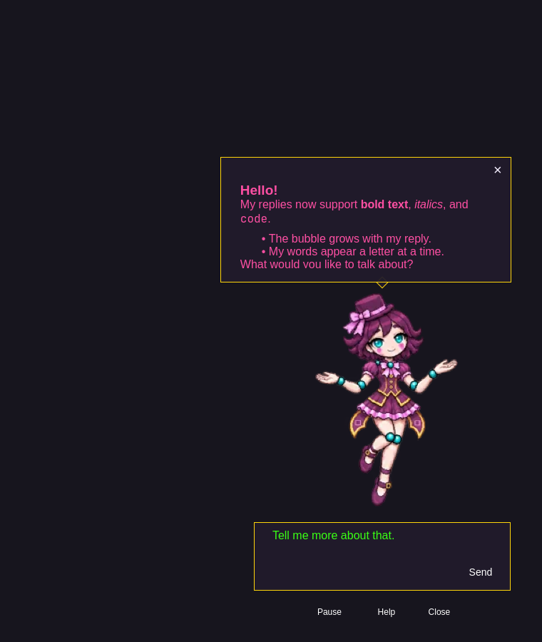

# Marionette desktop puppet

Native Qt Quick / Wayland interface to Marionette's local chat backend. Type in terminal green below her; formatted replies reveal quickly in terminal pink inside a growing bubble. She stays idle during generation and text reveal; giggling is click-only. Build/run/stop commands, shortcuts, connection/reset behavior and limitations are in the [operation guide](../../docs/active/current-operation/desktop-puppet.md).

The approved idle and giggle atlases are embedded in the binary; the screenshot above is an offscreen preview with a synthetic reply. The Python backend owns identity, tools, memory and conversation storage; the replaceable desktop client holds only its current draft and bubble in RAM.
